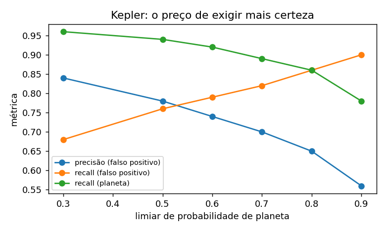
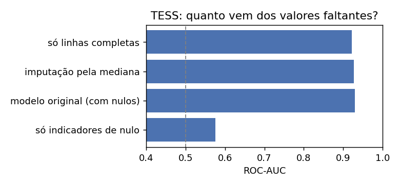
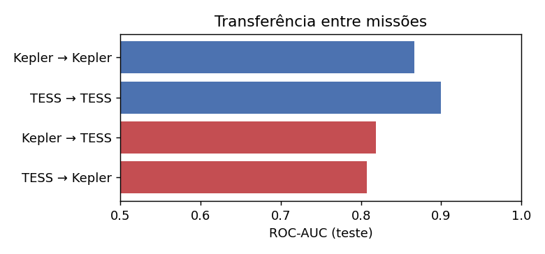
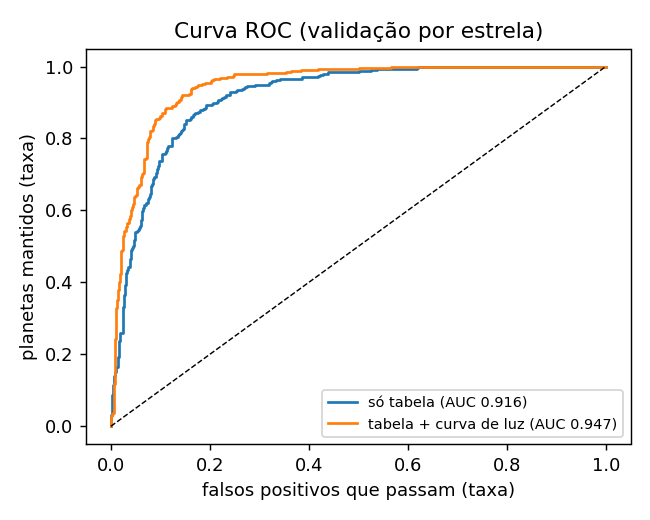
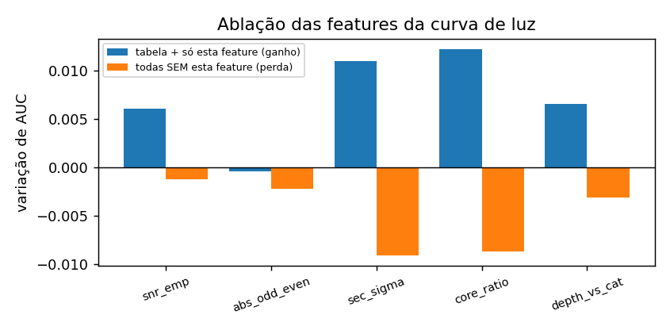

# Detecção de exoplanetas com dados do Kepler e do TESS

Classificador de candidatos a planeta (**planeta confirmado × falso positivo**) construído com catálogos do NASA Exoplanet Archive e, numa segunda fase, com features extraídas das **curvas de luz** do Kepler. O foco do projeto não é só o modelo, mas **medir com cuidado o que ele aprende**: validação separada por estrela, checagem de atalhos nos dados e intervalos de confiança.

> Notebook completo: [`notebooks/exoplanet_detection.ipynb`](notebooks/exoplanet_detection.ipynb) (Python, scikit-learn, lightkurve)

## Resultados principais

| Pergunta | Resultado |
|---|---|
| **Kepler**: dá para separar planetas de falsos positivos só com o catálogo? | ROC-AUC ≈ **0,92** (3.018 KOIs rotulados, validação por estrela). Features físicas (`rp_rs`, razão de duração) elevam a PR-AUC da classe "falso positivo" de 0,822 para 0,841 no Random Forest (0,843 com HistGradientBoosting), ganho consistente em 5 divisões |
| **TESS**: e na outra missão? | ROC-AUC ≈ **0,92–0,93** (2.242 TOIs rotulados). Valores faltantes funcionam como atalho, mas o efeito é pequeno (ver abaixo) |
| O que se aprende **transfere entre missões**? | Kepler→TESS **0,819**, TESS→Kepler **0,807**, contra 0,866 e 0,899 treinando na própria missão: perda de 0,06 a 0,09 |
| **Curvas de luz** acrescentam informação ao catálogo? | Sim, de forma modesta: ROC-AUC de 0,911 (só catálogo) para **0,943** (catálogo + curva). Diferença +0,030, IC 95% de bootstrap por estrela **[+0,019, +0,042]** |
| Onde o ganho aparece? | Períodos curtos e médios (+0,047 e +0,045, ICs acima de zero). Nos períodos longos, +0,014 com IC [−0,011, +0,038], indistinguível de zero |
| Efeito prático | Mantendo 95% dos planetas, passam **92** falsos positivos (de 499) com a curva, contra **159** só com o catálogo |

*Valores da execução no Kaggle. Em outra versão das bibliotecas, o ROC-AUC variou cerca de 0,01 nos meus testes; o recall no limiar fixo de 0,5 varia mais (0,63 contra 0,74 para falsos positivos, no Random Forest), por isso o notebook mostra a troca entre limiares em vez de um valor único.*

## Figuras

| | |
|---|---|
|  |  |
|  |  |



## Dados

[Kepler & TESS Exoplanet Data](https://www.kaggle.com/datasets/vijayveersingh/kepler-and-tess-exoplanet-data) (Kaggle): sete tabelas do NASA Exoplanet Archive. **Não contém curvas de luz.** Foram usadas a tabela de KOIs do Kepler (`q1_q8_koi`) e a de TOIs do TESS. As curvas de luz da segunda fase vêm do arquivo MAST (Kepler, cadência longa, `PDCSAP_FLUX`).

## O que o projeto tem de diferente

- **Validação por estrela** (`GroupKFold` / `StratifiedGroupKFold`): estrelas com vários candidatos nunca aparecem no treino e no teste ao mesmo tempo.
- **Checagem de vazamento:** colunas que entregam a resposta (`koi_pdisposition`, flags de falso positivo, `fpp_prob`) ficam de fora; `koi_insol` foi descartada por estar 100% vazia.
- **Atalho dos valores faltantes no TESS:** 94% dos objetos com dados estelares faltando são não planetas. Um modelo que só vê *"está faltando?"* chega a AUC 0,58; remover a pista custa menos de 0,01 de AUC. A imputação pela mediana **não** esconde o atalho (as linhas com nulo ficam com o mesmo valor, que uma árvore isola).
- **O modelo não usa o período como atalho:** a fração de planetas varia muito com o período, mas o AUC **dentro** de cada faixa continua entre 0,87 e 0,94.
- **Ruído medido, não assumido:** nas curvas de luz, o ruído foi estimado em fases aleatórias. No Kepler-10 b, o ruído real foi cerca de 2× o de ruído branco, e um "eclipse secundário" de 30 ppm que parecia existir em 10 dias de dados caiu para 2,7 ppm (1,1 σ) com 14 trimestres.
- **Hipóteses descartadas, registradas:** a perda de transferência entre missões não se explica por cobertura de medidas, por escala absoluta nem por usar só razões físicas (todas testadas, nenhuma confirmou).

## Pipeline das curvas de luz

Para cada KOI, a curva é dobrada na efeméride do catálogo e o notebook mede cinco features: `snr_emp` (profundidade ÷ ruído empírico), `abs_odd_even` (trânsitos pares × ímpares), `sec_sigma` (eclipse secundário), `core_ratio` (trânsito em "V" × em "U") e `depth_vs_cat`. Os trânsitos dos outros KOIs da mesma estrela são mascarados.

O servidor de **busca** do MAST (usado pelo `lightkurve`) travou durante o projeto, então os arquivos foram baixados direto do endpoint de download, estrela por estrela, processados e apagados (~620 estrelas/hora; 999 de 1.000 KOIs processados com sucesso em 82 min).

## Estrutura do repositório

```
├── README.md
├── requirements.txt
├── notebooks/exoplanet_detection.ipynb   # notebook completo, com saídas
├── data/
│   ├── README.md                         # como baixar o dataset de entrada
│   └── features_lc_1000.csv              # features das curvas de luz (1.000 KOIs)
├── results/
│   ├── kepler_previsoes_abertos.csv      # candidatos do Kepler ordenados por probabilidade
│   └── tess_previsoes_candidatos.csv     # candidatos do TESS (duas camadas de confiança)
└── figures/                              # figuras do notebook
```

## Como reproduzir

**No Kaggle (mais simples):** adicione o dataset acima como entrada e rode o notebook com *Run All*. As seções 1 a 4 não precisam de internet. Na seção 5, com `RUN_EXTRACTION = False` (padrão) o notebook usa `features_lc_1000.csv` se estiver como entrada; com `RUN_EXTRACTION = True` (internet ligada) ele baixa as curvas e calcula as features. Para o job longo, use *Save & Run All* em um notebook separado.

**Localmente:**

```bash
git clone https://github.com/SEU_USUARIO/exoplanet-detection.git
cd exoplanet-detection
pip install -r requirements.txt
# baixe o dataset em data/raw/ (veja data/README.md) e rode a partir da pasta do notebook:
cd notebooks
DATA_DIR=../data jupyter notebook exoplanet_detection.ipynb     # Linux/macOS
```

No Windows (PowerShell): `$env:DATA_DIR="../data"` antes de `jupyter notebook`. O notebook procura os arquivos de entrada em `DATA_DIR` e grava as saídas em `outputs/`.

## Limitações

- **Circularidade dos rótulos.** O vetting que gera `CONFIRMED`/`FALSE POSITIVE` usa critérios parecidos com as features (SNR, duração, eclipse secundário, forma). O modelo não vê os rótulos, mas o AUC mede o quanto ele **reproduz esse julgamento**, não a natureza física dos objetos.
- **Sem verdade de referência** para os candidatos abertos: as probabilidades servem para ordenar, não são calibradas.
- **Amostra das curvas de luz balanceada (50/50)**, diferente da tabela (77/23): vale para comparar modelos por AUC, não para precisão e recall absolutos. As contagens de falsos positivos vêm de uma única amostra, sem intervalo de confiança.
- **Os 1.000 KOIs incluem parte de um lote exploratório de 200**, então os resultados não são totalmente independentes dele.
- **Hiperparâmetros fixos**, escolhidos a priori, sem ajuste nestes dados.
- **No TESS**, `log_snr_depth` é uma aproximação (profundidade ÷ erro), não o SNR do pipeline.
- O método **não vê** falsos positivos por contaminação ou deslocamento de centroide.

## Próximos passos

- Aplicar o modelo com curvas de luz aos ≈850 candidatos abertos do Kepler e comparar o ranking com o do modelo só de tabela.
- Extrair as mesmas features para o TESS (curvas do SPOC).
- Calibrar as probabilidades e reportar precisão e recall com a prevalência real de planetas.
- Testar uma CNN 1D na curva dobrada, usando as features atuais como linha de base.
